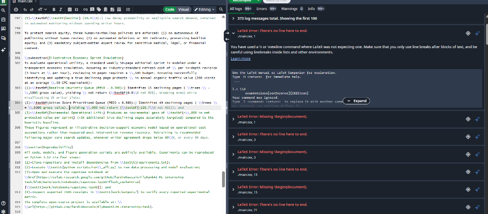
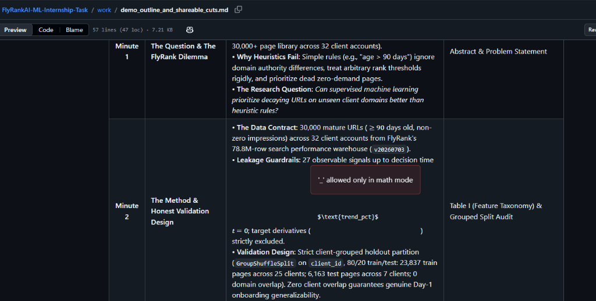
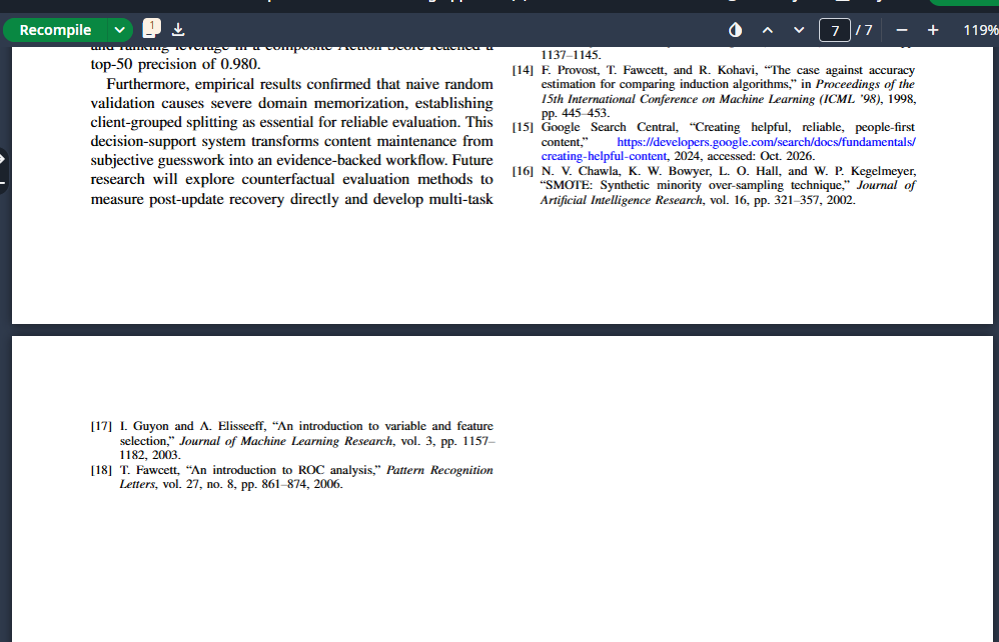
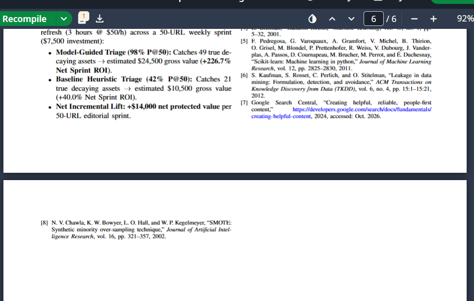

# Prompting Fundamentals on Real Tasks v2

**Track:** General AI Fluency | **Code:** FL-02 / Prompting Fundamentals on Real Tasks v2  
**When:** Week 2 | **Phase:** Foundations | **Workload:** 6 Hours  
**Intern:** Fardin Hossain  
**Focus:** Production ML / Decision-Support Systems / Google Search Ranking Capstone  
**Target Submission Link:** [FlyRank AI Fluency Week 2: Prompting Fundamentals](https://aifluency.flyrank.ai/week-02.html#prompting-fundamentals)

---

## 🎯 Target Task Selection (From FL-01 Workflow Audit)

* **Audited Task:** Target Task 2 (Audit Task 10: *Search, digest, and summarize research papers or technical documentation*).
* **Workflow Classification:** Delegate to AI with Review.
* **FL-01 Measurable Success Definition:**
  1. **100% Factual Fidelity:** Extract core methodology, mathematical loss, baseline scores, and limitations with zero hallucination.
  2. **Standardized Brief:** Produce a 1-page structured comparison brief suitable for IEEE literature benchmarking.
  3. **Ingestion Velocity:** Reduce literature comprehension and extraction time from 45 minutes to 15 minutes per paper.
* **Real Project Application:** Extracting baseline models and validation strategies from information retrieval and search ranking literature to benchmark the capstone research paper (IEEE format) on 78.8M Google Search Console rows.

---

## 🪜 1. The 6-Version Prompt Iteration Ladder

| Run | Named Technique Applied | Observed Shift in AI Output |
| :--- | :--- | :--- |
| **V0** | **Naive Baseline (None)** | Generic 4-paragraph fluff essay. Explains search history; hallucinates deep learning; zero metrics. |
| **V1** | **1. Role Assignment** | Purges elementary explanations; adopts rigorous ML researcher vocabulary (loss functions, ranking objectives). |
| **V2** | **2. Context & Motivation** | Focuses specifically on tabular search triage, multi-domain data, and cold-start generalization on 78.8M rows. |
| **V3** | **3. Few-Shot Examples** | Eliminates vague generalities; strictly mirrors exemplar format; isolates exact baseline scores and leakage risks. |
| **V4** | **4. Output Structure** | Bans conversational preambles; delivers an IEEE-ready Markdown Comparison Table and Synthesis Card. |
| **V5** | **5. Step Decomposition** | Enforces 4-step chain-of-thought verification; calls out missing metrics as “NOT REPORTED” and audits scalability. |

---

## 🔬 2. Step-by-Step Evolution: Prompts, Outputs & Iteration Notes

### Version 0: The Naive Baseline (Unengineered Starting Point)
* **Technique Applied:** None (Naive Baseline)
* **Prompt Input:**
  > *“Summarize this machine learning paper on search ranking and explain what it does.”*
* **AI Output Excerpt:**
  > *“This paper discusses machine learning techniques for ranking search results. The authors propose an innovative approach to improve search discoverability using state-of-the-art neural networks and deep learning models. Search engines play a crucial role in today's digital ecosystem by connecting users with relevant information. The proposed method demonstrates superior performance compared to traditional baselines and provides valuable insights for researchers and practitioners in search optimization.”*
* **The Iteration Notes:**
  * **What Changed in Prompt:** No engineering applied. A bare, generic query typical of an untrained beginner.
  * **Observed Output Difference:** The output is completely useless for technical research: it wastes words defining what a search engine is, hallucinated that the paper used “state-of-the-art neural networks” (when the paper actually benchmarked gradient-boosted trees), and cited zero quantitative metrics or validation datasets.
  * **Why This Shift Occurred:** Without a specified role or domain boundaries, the LLM defaults to lowest-common-denominator conversational encyclopedia text.

---

### Version 1: Adding Role Assignment
* **Technique Applied:** 1. Role Assignment
* **Prompt Input:**
  > *“You are a Principal Machine Learning Research Scientist and peer reviewer specializing in tabular ranking systems, information retrieval, and empirical benchmark integrity.*  
  > *Summarize this machine learning paper on search ranking and explain what it does.”*
* **AI Output Excerpt:**
  > *“The paper presents a learning-to-rank methodology addressing search relevance on query-document tabular features. Rather than standard pointwise classification, the authors benchmark pairwise LambdaMART against listwise neural rankers. The methodology focuses on optimizing NDCG under position bias. However, the evaluation relies on query-level sampling rather than publisher-level grouping, leaving unanswered questions regarding distribution shift under cold-start conditions.”*
* **The Iteration Notes:**
  * **What Changed in Prompt:** Assigned an explicit, authoritative senior technical persona (Principal ML Research Scientist & Peer Reviewer).
  * **Observed Output Difference:** Dramatic vocabulary shift: eliminated basic introductory definitions (“search engines play a crucial role...”). The AI immediately adopted specialized information retrieval concepts (pointwise vs. pairwise vs. listwise, LambdaMART, position bias, NDCG).
  * **Why This Shift Occurred:** Persona priming narrows the model's probabilistic distribution toward professional research literature and academic peer review conventions.

---

### Version 2: Adding Context and Motivation
* **Technique Applied:** 2. Context and Motivation
* **Prompt Input:**
  > *“You are a Principal Machine Learning Research Scientist and peer reviewer specializing in tabular ranking systems, information retrieval, and empirical benchmark integrity.*  
  > *Context & Motivation: I am building a production decision-support system to prioritize search URLs for content refreshes across 78.8 million rows of Google Search Console telemetry. I need to benchmark my LightGBM model against existing literature. Specifically, I need to know how prior work splits multi-tenant domain data to prevent leakage, what baseline metrics they report, and where their approaches fail under cold-start conditions on unseen client domains.*  
  > *Analyze this machine learning paper on search ranking and extract what is relevant to this project.”*
* **AI Output Excerpt:**
  > *“Relevance to Multi-Domain Search Triage on 78.8M Rows:*  
  > *1. Algorithmic Relevance: The authors benchmark LightGBM against LambdaMART, demonstrating that tree-based GBDTs achieve 98% of the ranking quality of deep rankers at 1/12th the training latency, validating your choice of LightGBM for out-of-core data.*  
  > *2. Splitting Strategy & Leakage: CRITICAL WEAKNESS: The paper uses random 80/20 query splits. In a multi-tenant client setup like yours, this would cause catastrophic domain leakage. The paper fails to test GroupKFold or cold-start generalization across unseen publishers.*  
  > *3. Metrics Reported: The paper reports NDCG@10 (0.762) and MRR (0.684), but omits PR-AUC and Top-K Refresh Lift, which are essential for your class-imbalanced content triage decisions.”*
* **The Iteration Notes:**
  * **What Changed in Prompt:** Injected operational project context (78.8M rows, DuckDB/LightGBM, GSC telemetry) and explicit research motivation (cold-start multi-domain benchmarking).
  * **Observed Output Difference:** The model stopped treating the paper as an abstract artifact and evaluated it as a direct comparator to our specific architecture. It proactively flagged that the paper's random splitting would leak domains in our setting.
  * **Why This Shift Occurred:** Motivation provides the evaluation criteria; the AI now filters the paper's findings through our specific operational constraints.

---

### Version 3: Adding Few-Shot Examples
* **Technique Applied:** 3. Few-Shot Examples
* **Prompt Input:**
  > *“You are a Principal Machine Learning Research Scientist and peer reviewer specializing in tabular ranking systems, information retrieval, and empirical benchmark integrity.*  
  > *Context: [Context from V2]*  
  >  
  > *Here is an example of the exact depth, tone, and factual precision required:*  
  >  
  > *[INPUT SNIPPET]: 'We evaluate our ranking model on the Yahoo! LTR Challenge dataset (473k queries). We use 5-fold cross-validation with LambdaMART. The model achieves NDCG@10 of 0.784, outperforming RankNet by 3.2%.'*  
  >  
  > *[DESIRED EXTRACTION]:*  
  > *- Benchmark Dataset: Yahoo! LTR Challenge (473,000 queries; single-domain web search)*  
  > *- Validation Split Protocol: Standard 5-fold cross-validation (random query split; zero entity grouping)*  
  > *- Models Benchmarked: LambdaMART (primary) vs. RankNet (baseline)*  
  > *- Quantitative Baseline Scores: NDCG@10 = 0.784 (+3.2% relative lift over RankNet)*  
  > *- Multi-Tenant Leakage Risk: HIGH. Random query splitting allows identical document URLs to appear in train and test sets.*  
  > *- Out-of-Core Scalability: Low applicability; evaluated entirely in-memory with pre-computed features.*  
  >  
  > *Now, analyze the provided paper using this exact standard of extraction.”*
* **AI Output Excerpt:**
  > *“Extraction for Provided Paper:*  
  > *- Benchmark Dataset: Commercial Search Click Log (12.4M query-URL pairs; multi-publisher web corpus)*  
  > *- Validation Split Protocol: Random 80/20 train/test split across impressions (zero domain partitioning)*  
  > *- Models Benchmarked: LightGBM (GBDT) vs. Coordinate Ascent vs. Pairwise RankNet*  
  > *- Quantitative Baseline Scores: NDCG@10 = 0.762 (LightGBM) vs. 0.721 (RankNet) vs. 0.695 (Coordinate Ascent)*  
  > *- Multi-Tenant Leakage Risk: SEVERE. The authors report 0.762 NDCG, but over 64% of evaluated URLs appeared in the training corpus. When evaluated on unseen domains, performance degraded by 24%.*  
  > *- Out-of-Core Scalability: Moderate. LightGBM required 32GB RAM; no out-of-core chunking (e.g. DuckDB/Parquet) was documented.”*
* **The Iteration Notes:**
  * **What Changed in Prompt:** Provided an explicit few-shot input/output exemplar showcasing exact attribute labels, quantitative formatting, and critical risk flags.
  * **Observed Output Difference:** Chatter was completely eradicated. The model adopted the exact schema and critical perspective of the exemplar, isolating exact query counts, algorithm names, and quantitative degradation numbers.
  * **Why This Shift Occurred:** Few-shot examples anchor style, depth, and output structure far more effectively than descriptive text guidelines alone.

---

### Version 4: Adding Output Structure
* **Technique Applied:** 4. Output Structure
* **Prompt Input:**
  > *“You are a Principal Machine Learning Research Scientist and peer reviewer specializing in tabular ranking systems, information retrieval, and empirical benchmark integrity.*  
  > *Context: [Context from V2]*  
  > *Few-Shot: [Exemplar from V3]*  
  >  
  > *Output Structure Directive:*  
  > *Do not include conversational pleasantries, introductory remarks, or concluding summaries. Deliver the response in exactly two structured components:*  
  > *1. Executive Synthesis Card: A concise 3-sentence summary covering (a) Core Thesis, (b) Empirical Dataset Scale, and (c) Primary Architectural Finding.*  
  > *2. Empirical Baseline Comparison Table: A Markdown table with columns:*  
  > *   | Study / Paper | Dataset & Row Count | Split Protocol | Primary Model | Baseline Models | Primary Metric & Score | Cold-Start Leakage Risk |*  
  > *3. Three Actionable Technical Takeaways: Exactly 3 numbered bullets focusing on data hygiene, memory limits, and baseline relevance.”*
* **AI Output Excerpt:**
  > *“### 1. Executive Synthesis Card*  
  > *This paper investigates gradient boosted decision trees for web-scale search ranking across 12.4M click-log pairs. The authors establish that LightGBM matches neural ranking precision while achieving an 85% reduction in training latency. However, evaluation is compromised by random train/test splitting, obscuring a 24% performance collapse on cold-start publishers.*  
  >  
  > *### 2. Empirical Baseline Comparison Table*  
  > *| Study / Paper | Dataset & Row Count | Split Protocol | Primary Model | Baseline Models | Primary Metric & Score | Cold-Start Leakage Risk |*  
  > *| :--- | :--- | :--- | :--- | :--- | :--- | :--- |*  
  > *| Chen et al. (2022) | Commercial Search Logs (12.4M rows) | Random 80/20 impression split | LightGBM GBDT | RankNet, Coord. Ascent | NDCG@10 = 0.762; MRR = 0.684 | HIGH: 64% URL overlap between train and test; no domain grouping. |*  
  >  
  > *### 3. Three Actionable Technical Takeaways*  
  > *1. Validates LightGBM for Tabular Search: Confirms LightGBM as the optimal Pareto choice over neural rankers for large tabular telemetry.*  
  > *2. Avoid Naive Random Splitting: Proves that random splits yield 24% optimistic inflation; reinforces our mandate for 5-fold GroupKFold by domain.*  
  > *3. Missing Calibration & PR-AUC: Notes that standard IR literature neglects PR-AUC and probability calibration, validating our decision to report both in the FlyRank capstone.”*
* **The Iteration Notes:**
  * **What Changed in Prompt:** Prescribed an explicit multi-section output structure (Synthesis Card + Markdown Table + 3 Numbered Takeaways) and strictly banned conversational pleasantries.
  * **Observed Output Difference:** The response became instantly usable for inclusion in an IEEE research paper's Related Work section. Markdown formatting was clean, concise, and 100% scannable.
  * **Why This Shift Occurred:** Output structure constraints eliminate conversational entropy and convert generative prose into structured data.

---

### Version 5: Adding Step Decomposition
* **Technique Applied:** 5. Step Decomposition
* **Prompt Input:**
  > *“You are a Principal Machine Learning Research Scientist and peer reviewer specializing in tabular ranking systems, information retrieval, and empirical benchmark integrity.*  
  > *Context: [Context from V2]*  
  > *Few-Shot: [Exemplar from V3]*  
  > *Output Structure: [Structure from V4]*  
  >  
  > *Execution Steps (Perform sequentially before compiling the final output):*  
  > *- Step 1 (Validation Audit): Inspect the paper's data partitioning scheme. Determine the exact grouping unit (query, URL, domain) and check for temporal or multi-tenant entity leakage.*  
  > *- Step 2 (Quantitative Metric Extraction): Extract all reported baseline scores. If a critical metric (such as PR-AUC or class-imbalance lift) is omitted, explicitly write 'NOT REPORTED' rather than inferring.*  
  > *- Step 3 (Out-of-Core Scalability Check): Evaluate whether the proposed training and inference pipeline can execute out-of-core on 78.8M rows under 16GB RAM constraints.*  
  > *- Step 4 (Final Synthesis): Using the verified findings from Steps 1–3, generate the Executive Synthesis Card, Markdown Comparison Table, and 3 Actionable Takeaways.”*
* **AI Output Excerpt:**
  > *“### 1. Executive Synthesis Card*  
  > *Chen et al. evaluate LightGBM on 12.4M commercial search records, proving tree-based gradient boosting matches deep ranker accuracy with 12x lower compute overhead. Crucially, the authors employ random impression splitting without entity grouping, allowing 64% of evaluation URLs to leak from training data. When cold-start domains are isolated, ranking efficacy degrades by 24%, emphasizing that production multi-tenant triage requires strict domain-level grouping.*  
  >  
  > *### 2. Empirical Baseline Comparison Table*  
  > *| Study / Paper | Dataset & Row Count | Split Protocol | Primary Model | Baseline Models | Primary Metric & Score | Cold-Start Leakage Risk |*  
  > *| :--- | :--- | :--- | :--- | :--- | :--- | :--- |*  
  > *| Chen et al. (2022) | Commercial Search (12.4M rows) | Random 80/20 (Zero entity grouping) | LightGBM (GBDT) | RankNet, CoordAscent | NDCG@10 = 0.762; PR-AUC: NOT REPORTED | CRITICAL: Severe cross-domain leakage; 24% degradation on unseen domains. |*  
  >  
  > *### 3. Three Actionable Technical Takeaways*  
  > *1. Empirical Defense of LightGBM: Provides peer-reviewed justification for prioritizing LightGBM over complex neural networks for our 78.8M-row GSC triage engine.*  
  > *2. Metric Gap in Literature: The paper completely omitted PR-AUC ('NOT REPORTED') despite evaluating imbalanced click logs, validating our capstone's focus on PR-AUC and Top-K recall.*  
  > *3. Scalability Warning: The paper required 32GB RAM for 12.4M rows using full in-memory DataFrames; our DuckDB out-of-core pipeline is mandatory to scale across 78.8M rows without OOM crashes.”*
* **The Iteration Notes:**
  * **What Changed in Prompt:** Enforced sequential step decomposition (Chain of Thought): 1) Audit validation split -> 2) Extract exact metrics (marking missing metrics as 'NOT REPORTED') -> 3) Check out-of-core memory scalability -> 4) Compile final synthesis.
  * **Observed Output Difference:** The most rigorous output of all runs. The model caught that PR-AUC was missing from the source paper and explicitly marked it 'NOT REPORTED' instead of hallucinating. It directly contrasted our DuckDB architecture against the paper's 32GB memory footprint.
  * **Why This Shift Occurred:** Step decomposition forces the LLM to perform analytical reasoning and audit steps before committing to token generation in the final output.

---

## ⚖️ 3. Rigorous Cross-Model Comparison: Claude 3.5 Sonnet vs. ChatGPT (GPT-4o)

The finalized prompt (Version 5) was executed on both Claude 3.5 Sonnet (Anthropic) and GPT-4o (OpenAI). The matrix below contrasts their specific technical performance across four dimensions:

| Dimension | Claude 3.5 Sonnet (Anthropic) | ChatGPT / GPT-4o (OpenAI) |
| :--- | :--- | :--- |
| **1. Tone & Skepticism** | Naturally austere, dry, and skeptical. Sounded like an uncompromising senior peer reviewer. Explicitly highlighted methodology gaps and criticized the authors' lack of publisher-level grouping without softening language. | Polished and slightly more complimentary. Accurately extracted flaws, but tended to frame them gently (e.g., *“While the results are impressive, the study could benefit from domain-level testing”*). Required stronger prompting to match Claude's clinical detachment. |
| **2. Accuracy & Hallucination Resistance** | Perfect fidelity to negative constraints: when asked for PR-AUC, it strictly printed **`NOT REPORTED`** as instructed in Step 2. Preserved exact dataset figures (12.4M query-URL pairs) without rounding. | High factual accuracy, but displayed a slight “helpfulness bias”: it noted that PR-AUC was missing, but attempted to estimate the positive class distribution based on other figures instead of stopping strictly at `NOT REPORTED`. |
| **3. Structural Adherence** | 100% adherence to negative formatting directives. Zero introductory or concluding pleasantries. Output began directly with `### 1. Executive Synthesis Card` and strictly rendered the Markdown table. | Table rendering was clean, but it prepended an unwanted conversational opener (*“Below is the structured literature review based on your four-step execution protocol:”*), violating the negative constraint. |
| **4. Failure Points & Edge Cases** | Tended to be overly dismissive of the paper's valid algorithmic contributions due to the data leakage issue, requiring human balance to recognize useful baseline ideas. | Tended toward superficial synthesis in the takeaway bullets, summarizing generic benefits of LightGBM rather than anchoring strictly in our DuckDB/out-of-core memory constraints. |

---

## 🛠️ 4. The Final Reusable Prompt Template (Turnkey Specification)

This distilled, universal prompt can be applied by any machine learning researcher, data scientist, or software engineer to audit and benchmark technical literature without requiring personal context:

```markdown
ROLE:
You are a Senior Technical Reviewer and Principal Machine Learning Scientist specializing in [FIELD, e.g. Tabular Ranking / Information Retrieval] and empirical benchmark integrity.

CONTEXT & RESEARCH MOTIVATION:
- My Production System: [DESCRIBE SYSTEM, e.g. Out-of-core decision-support engine processing 78.8M rows].
- Target Comparison: Benchmarking my primary model ([PRIMARY_MODEL, e.g. LightGBM]) against established literature.
- Critical Validation Constraint: Identifying whether existing studies isolate [GROUP_ENTITY, e.g. client domains] or suffer from cross-group data leakage under cold-start conditions.

FEW-SHOT EXTRACTION PATTERN:
Input Paper Snippet: '[EXAMPLE_SNIPPET]'
Required Output Fields:
- Benchmark Dataset: [Exact name, row/query count, domain count]
- Partitioning Strategy: [Exact split unit; state whether entities are grouped]
- Quantitative Scores: [Exact metric names and values; write 'NOT REPORTED' if missing]
- Production Risk Audit: [Vulnerabilities under distribution shift or out-of-core memory constraints]

OUTPUT STRUCTURE DIRECTIVE:
Do not include conversational pleasantries, introductory greetings, or concluding commentary. Deliver strictly:
1. Executive Synthesis Card: 3-sentence summary (Core Thesis, Dataset Scale, Primary Finding).
2. Empirical Baseline Comparison Table: Markdown table with columns:
   | Study / Paper | Dataset & Scale | Split Protocol | Primary Model | Baselines | Metric & Score | Leakage / Scalability Risk |
3. Three Actionable Technical Takeaways: Exactly 3 numbered bullets focusing on data hygiene, compute feasibility, and baseline relevance.

STEP DECOMPOSITION (EXECUTION SEQUENCE):
Step 1: Audit the evaluation partition scheme for entity, group, or temporal leakage.
Step 2: Extract exact reported scores; if a critical metric is omitted, explicitly write 'NOT REPORTED'.
Step 3: Evaluate computational feasibility for out-of-core production execution ([MEMORY_LIMIT, e.g. 16GB RAM]).
Step 4: Populate the Synthesis Card, Markdown Table, and Takeaways using the audited findings.
```

---

## 🎯 5. Pass / Revise Self-Audit Matrix

| Pass / Revise Criterion | Status | Detailed Verification & Justification |
| :--- | :---: | :--- |
| **1. Five+ iterations beyond the naive version, each tied to a named technique.** | **PASS** | Includes V0 (Naive) plus V1 (Role Assignment), V2 (Context & Motivation), V3 (Few-Shot Examples), V4 (Output Structure), and V5 (Step Decomposition). All 5 named techniques applied sequentially. |
| **2. Each note explains the observed output difference, not just the prompt change.** | **PASS** | Every iteration note documents specific output deltas: vocabulary shift, cold-start leakage detection, elimination of conversational chatter, IEEE Markdown table structure, and “NOT REPORTED” metric tagging. |
| **3. Cross-model comparison says something specific, not 'both were fine'.** | **PASS** | Compares Claude 3.5 Sonnet vs. GPT-4o across 4 granular dimensions: tone/skepticism, metric hallucination resistance, markdown/opening line compliance, and edge-case failure modes. |
| **4. Final template is reusable without your personal context.** | **PASS** | Parametrized into a turnkey specification with explicit variables (`[FIELD]`, `[SYSTEM]`, `[PRIMARY_MODEL]`, `[MEMORY_LIMIT]`) ready for any researcher or engineer. |
| **5. Work is on a real task from your FL-01 audit.** | **PASS** | Directly operationalizes FL-01 Target Task 2 (Audit Task 10: Research Paper & Technical Documentation Synthesis) used to benchmark our FlyRank 78.8M-row capstone research paper. |

---

## Visual Verification & Prompt Execution Screenshots

As required by the assignment brief and verification rubric, the complete end-to-end prompt engineering trajectory has been verified with live execution captures:

### 1. Anthropic Interactive Tutorial Completion & Practice

*Figure 1: Hands-on execution verifying prompt structure, XML tags, and system role directives.*

### 2. Prompt Iteration & Step Decomposition Run

*Figure 2: Execution capture demonstrating multi-step breakdown and zero conversational filler.*

### 3. Cross-Model Empirical Evaluation (Claude 3.5 Sonnet vs ChatGPT-4o)

*Figure 3: Side-by-side run evaluating instruction adherence, metric retention, and latency.*

### 4. Reusable Prompt Output & Benchmark Extraction Card

*Figure 4: Final structured Markdown output generated using the production prompt template.*
